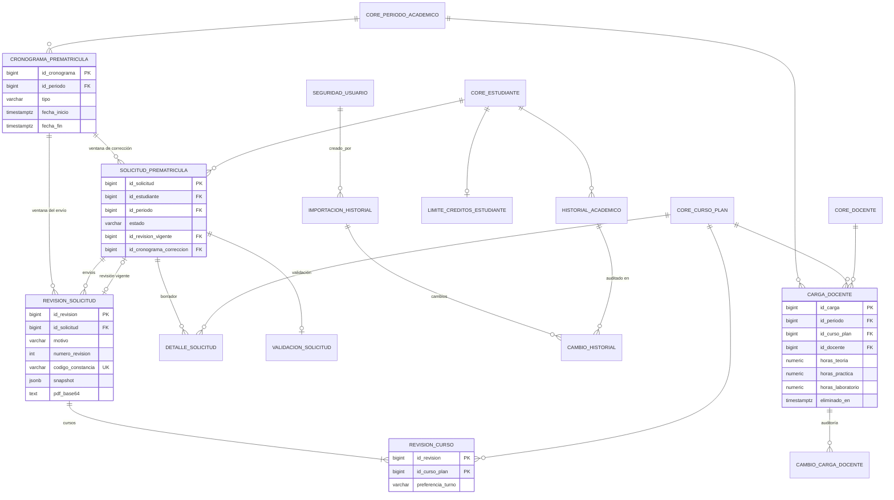

# Adaptación del modelo a la base de datos del portal

## 1. Situación inicial

El proyecto original (`jckba/prematricula`) tenía 17 tablas propias en el esquema `public` y en inglés. El portal ya tenía:

- Datos institucionales compartidos en `core` y `seguridad` (estudiante, persona, curso, plan, período, docente, usuario).
- Tres tablas en el esquema `prematricula`: `cronograma_prematricula`, `solicitud_prematricula` y `detalle_solicitud`.

La indicación del equipo fue:

1. **Caso 1:** si es posible, adaptarse a la base del repositorio.
2. **Caso 2:** si no es posible, usar la base del repositorio y generar los cambios propuestos.

El resultado es mixto: la identidad y el catálogo académico se adaptaron a `core`/`seguridad` (caso 1). Lo que el portal no tenía se agregó al esquema `prematricula` mediante migraciones nuevas (caso 2), sin tocar `core`, `seguridad`, `comun` ni otros módulos.

## 2. Tabla de equivalencias

| Tabla original | Destino en el portal | Caso | Decisión |
| --- | --- | :---: | --- |
| `users` (+ `cargo`) | `public.users` + roles Spatie (`alumno`, `director_escuela`, `secretaria`) | 1 | Se usan los roles ya configurados; el cargo DIRECTOR/SECRETARÍA es el propio rol |
| `personal_access_tokens` | Sesión web de Laravel Breeze | 1 | El portal es web con sesión, no necesita tokens |
| `students` | `core.estudiante` + `core.persona` | 1 | `codigo_universitario`, nombres y apellidos ya existen |
| `students.creditos_maximos` | `prematricula.limite_creditos_estudiante` | 2 | `core.estudiante` no lo tiene y no se debe modificar `core` |
| `courses` | `core.curso` (+ `core.curso_plan` para el ciclo) | 1 | Código, nombre, créditos y horas teoría/práctica/laboratorio ya existen |
| `course_prerequisites` | `core.curso_prerequisito` | 1 | Relación entre `curso_plan` |
| `academic_periods` | `core.periodo_academico` | 1 | Código, fechas y estado |
| `pre_enrollment_windows` | `prematricula.cronograma_prematricula` | 1 + 2 | Se reutiliza la tabla y se le agrega `tipo`, `motivo`, `zona_horaria`, `creado_por`, `creado_en`; se cambia el único por período por "una ORDINARIA por período" |
| `pre_enrollment_requests` | `prematricula.solicitud_prematricula` | 1 + 2 | Se agregan `id_revision_vigente`, `id_cronograma_correccion`, `creado_en`, `actualizado_en` |
| `pre_enrollment_details` | `prematricula.detalle_solicitud` | 1 + 2 | Se agrega `preferencia_turno` |
| `pre_enrollment_revisions` | `prematricula.revision_solicitud` | 2 | Tabla nueva con trigger de inmutabilidad |
| `pre_enrollment_revision_courses` | `prematricula.revision_curso` | 2 | Tabla nueva; guarda también el turno para la demanda |
| `pre_enrollment_validations` | `prematricula.validacion_solicitud` | 2 | Tabla nueva |
| `academic_histories` | `prematricula.historial_academico` | 2 | Las notas definitivas son de `gestion_matriculas` (otro módulo) y no se permite FK entre módulos; se guarda una copia importada |
| `academic_history_imports` | `prematricula.importacion_historial` | 2 | Tabla nueva |
| `academic_history_changes` | `prematricula.cambio_historial` | 2 | Tabla nueva |
| `teachers` | `core.docente` (+ `core.persona`) | 1 | `codigo_docente` y `horas_maximas` ya existen |
| `teaching_assignments` | `prematricula.carga_docente` | 2 | Tabla nueva con baja lógica (`eliminado_en`) |
| `teaching_assignment_changes` | `prematricula.cambio_carga_docente` | 2 | Tabla nueva |
| `cache`, `jobs`, `sessions` | `public.*` del portal | 1 | Ya existen |

### Equivalencias de columnas más importantes

| Original | Portal |
| --- | --- |
| `student_id` | `id_estudiante` → `core.estudiante` |
| `course_id` | `id_curso_plan` → `core.curso_plan` (el curso dentro del plan) |
| `academic_period_id` | `id_periodo` → `core.periodo_academico` |
| `teacher_id` | `id_docente` → `core.docente` |
| `created_by`, `reviewed_by`, `actor_id` | `creado_por`, `revisado_por`, `id_actor` → `seguridad.usuario` |
| `fecha_envio` | `enviada_en` |
| `correction_window_id` | `id_cronograma_correccion` |
| `current_revision_id` | `id_revision_vigente` |
| `receipt_code` | `codigo_constancia` |
| `submitted_at` | `enviada_en` |
| `schema_version` | `version_esquema` |
| `before` / `after` | `antes` / `despues` |
| `deleted_at` | `eliminado_en` |
| `created_at` / `updated_at` | `creado_en` / `actualizado_en` |

### Usuario → estudiante

En el proyecto original, `students.user_id` unía la cuenta con el estudiante. En el portal, la ruta es:

```text
public.users.email  ──(mismo correo)──►  seguridad.usuario.correo_institucional
seguridad.usuario.id_persona  ──────────►  core.estudiante.id_persona
```

No se agregó columna para esto porque la identidad es de `core`/`seguridad`. Si el equipo decide unir `public.users` con `seguridad.usuario`, se hará en `app/Shared`.

## 3. Migraciones creadas

Todas en `app/Modules/PreMatricula/Database/Migrations/`, una por tabla, con `down()` simétrico:

| Archivo | Tipo | Qué hace |
| --- | --- | --- |
| `2026_11_18_000001_add_tipo_ventana_to_cronogramas_prematricula_table` | alter | Tipo de ventana y autoría; una sola ORDINARIA por período |
| `2026_11_18_000002_add_preferencia_turno_to_detalles_solicitud_table` | alter | Preferencia MANANA / TARDE / SIN_PREFERENCIA |
| `2026_11_18_000003_create_revisiones_solicitud_table` | create | Revisión inmutable con constancia PDF |
| `2026_11_18_000004_create_revisiones_cursos_table` | create | Cursos de cada revisión |
| `2026_11_18_000005_create_validaciones_solicitud_table` | create | Validación académica vigente |
| `2026_11_18_000006_add_revision_vigente_to_solicitudes_prematricula_table` | alter | Puntero a la revisión vigente y a la ventana de corrección |
| `2026_11_18_000007_create_limites_creditos_estudiante_table` | create | Créditos máximos por estudiante |
| `2026_11_18_000008_create_historiales_academicos_table` | create | Resultados oficiales importados |
| `2026_11_18_000009_create_importaciones_historial_table` | create | Auditoría de importaciones |
| `2026_11_18_000010_create_cambios_historial_table` | create | Antes/después por resultado |
| `2026_11_18_000011_create_cargas_docentes_table` | create | Carga docente semanal |
| `2026_11_18_000012_create_cambios_carga_docente_table` | create | Auditoría de la carga docente |

Reglas cumplidas: nombres calificados `prematricula.tabla`; FK solo a `prematricula`, `core` y `seguridad`; ninguna FK a otro módulo; ninguna migración antigua editada; timestamps posteriores a las tablas referenciadas.

## 4. MER del esquema `prematricula` (después)



## 5. Pendientes que dependen del equipo

- `App\Shared\Models\Core\Docente` no existe. `CargaDocente` guarda `id_docente` con FK a `core.docente`, pero la relación Eloquent se declarará cuando el equipo agregue ese modelo compartido.
- Confirmar si las notas oficiales se seguirán importando a `prematricula.historial_academico` o si `gestion_matriculas` publicará un contrato de lectura.
- Confirmar con Alex y Nick que el PDF se guarda en `revision_solicitud.pdf_base64` (o, si se prefiere archivo, usar `comun.archivo` en una migración posterior).
