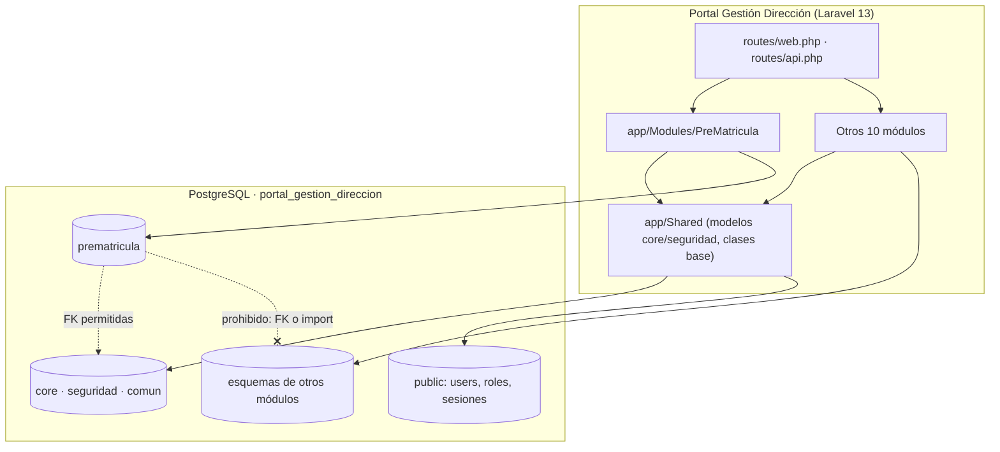
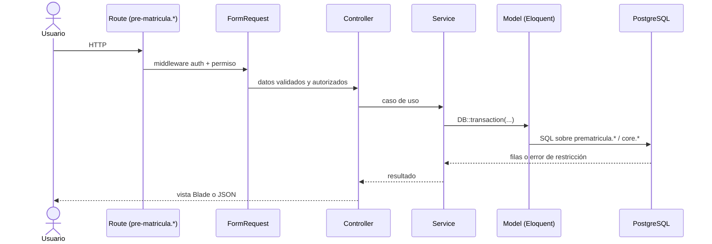

# Manual de arquitectura — Módulo Pre Matrícula

## 1. Lugar del módulo en el portal

El portal es un **monolito modular** en Laravel 13 con PostgreSQL 17. Se despliega como una sola aplicación, pero cada módulo es dueño de su carpeta de código, sus vistas, sus rutas y su esquema de base de datos.



| Dato | Valor |
| --- | --- |
| Módulo | Pre Matrícula |
| Slug / URL | `pre-matricula` |
| Esquema | `prematricula` |
| Código | `app/Modules/PreMatricula/` |
| Vistas | `resources/views/modules/pre-matricula/` |
| Pruebas | `tests/Feature/PreMatricula/`, `tests/Unit/PreMatricula/` |
| Permiso base | `pre-matricula.view` |

## 2. Estructura de carpetas

```text
app/Modules/PreMatricula/
├── Controllers/PreMatriculaController.php
├── Database/Migrations/          # 3 originales + 12 de la adaptación
├── Models/                       # 13 modelos (ver sección 4)
├── Policies/RegistroPolicy.php
├── Requests/PreMatriculaRequest.php
├── Routes/{web,api}.php          # prefijo pre-matricula, nombres pre-matricula.*
└── Services/PreMatriculaService.php
```

## 3. Flujo de una petición



- **Controller:** delgado; no contiene reglas de negocio.
- **Request:** valida la entrada y autoriza (`authorize()`).
- **Service:** casos de uso y transacciones. Ejemplos: `crearSolicitud()` y `demandaPorCurso()`.
- **Model:** solo persistencia y relaciones.

## 4. Modelos

| Modelo | Tabla | Relaciones principales |
| --- | --- | --- |
| `CronogramaPrematricula` | `prematricula.cronograma_prematricula` | `periodo`, `autor`, `revisiones`; método `estaActiva()` |
| `SolicitudPrematricula` | `prematricula.solicitud_prematricula` | `estudiante`, `periodo`, `detalles`, `revisiones`, `revisionVigente`, `validacion`, `cronogramaCorreccion` |
| `DetalleSolicitud` | `prematricula.detalle_solicitud` | `solicitud`, `cursoPlan`, `seccionPreferida` |
| `RevisionSolicitud` | `prematricula.revision_solicitud` | `solicitud`, `cronograma`, `cursos`, `cursosPlan`; oculta `pdf_base64` |
| `RevisionCurso` | `prematricula.revision_curso` | `revision`, `cursoPlan` |
| `ValidacionSolicitud` | `prematricula.validacion_solicitud` | `solicitud`, `revision` |
| `LimiteCreditosEstudiante` | `prematricula.limite_creditos_estudiante` | `estudiante`; `creditosPara()` devuelve 22 por defecto |
| `HistorialAcademico` | `prematricula.historial_academico` | `estudiante`, `cursoPlan`, `periodo`, `cambios` |
| `ImportacionHistorial` | `prematricula.importacion_historial` | `autor`, `cambios` |
| `CambioHistorial` | `prematricula.cambio_historial` | `importacion`, `historial` |
| `CargaDocente` | `prematricula.carga_docente` | `periodo`, `cursoPlan`, `autor`, `editor`, `cambios`; baja lógica |
| `CambioCargaDocente` | `prematricula.cambio_carga_docente` | `carga`, `actor` |
| `Registro` | `prematricula.solicitud_prematricula` | Plantilla del portal; la usa `ModuleSchemaIsolationTest`, no se borra |

Los datos institucionales se leen con los modelos compartidos `App\Shared\Models\Core\{Estudiante, Persona, Curso, CursoPlan, PeriodoAcademico, Seccion}` y `App\Shared\Models\Seguridad\Usuario`. El módulo no copia esos modelos ni importa clases de otros módulos.

## 5. Reglas que garantiza la base de datos

| Regla de negocio | Cómo se garantiza |
| --- | --- |
| Una solicitud por estudiante y período | `pre_sol_est_periodo_uq` |
| Un curso no se repite en el borrador | `pre_det_sol_curso_uq` |
| Una sola ventana ORDINARIA por período; varias EXTRAORDINARIA | índice único parcial `pre_crono_una_ordinaria_uq` + `pre_crono_tipo_ck` |
| Ventana con fin posterior al inicio | `pre_crono_fechas_ck` |
| Preferencia de turno válida | `pre_det_turno_ck`, `pre_rev_curso_turno_ck` |
| Un envío siempre tiene número, constancia, fecha y PDF | `pre_rev_envio_completo_ck` |
| Las revisiones enviadas no se modifican ni borran | trigger `pre_revision_inmutable` |
| La revisión vigente pertenece a la misma solicitud | FK compuesta `pre_sol_rev_vigente_fk` |
| Una validación por solicitud con estado válido | `pre_val_solicitud_uq`, `pre_val_estado_ck` |
| Un resultado por estudiante/curso/período; nota de 0 a 20 | `pre_hist_est_curso_per_uq`, `pre_hist_nota_ck` |
| Carga docente con horas no negativas y total positivo | `pre_carga_horas_ck` |
| Una carga vigente por período/curso/docente; la baja la libera | índice único parcial `pre_carga_vigente_uq` |

Las reglas que dependen de varias filas (créditos máximos, prerrequisitos, ventana activa, horas máximas del docente) van en los Services, dentro de transacciones.

## 6. Demanda por curso (insumo del dashboard)

`PreMatriculaService::demandaPorCurso($idPeriodo)` devuelve por curso: código, nombre, ciclo, estudiantes y conteo por turno. Solo cuenta la **revisión vigente** de cada solicitud con motivo `ENVIO`; los borradores, las capturas heredadas y las versiones reemplazadas no suman.

## 7. Roles

| Rol del proyecto original | Rol en el portal (Spatie) |
| --- | --- |
| `ESTUDIANTE` | `alumno` |
| `COORDINADOR` / `DIRECTOR_ESCUELA` | `director_escuela` |
| `COORDINADOR` / `SECRETARIA` | `secretaria` |

Los docentes no tienen cuenta en este módulo (igual que en el proyecto original).

## 8. Cómo probar

```bash
# Migrar solo el módulo (aplica antes lo compartido)
docker compose exec app php artisan module:migrate pre-matricula
docker compose exec app php artisan module:migrate:status pre-matricula

# Pruebas (instalación local, contra una base de pruebas separada)
vendor/bin/phpunit --filter=PreMatricula
vendor/bin/phpunit tests/Unit/ModuleStructureTest.php
```

> Las pruebas que usan `RefreshDatabase` ejecutan `migrate:fresh`, que vacía `public.migrations`. Por eso hay que correrlas contra una base de pruebas, nunca contra la base de desarrollo.
