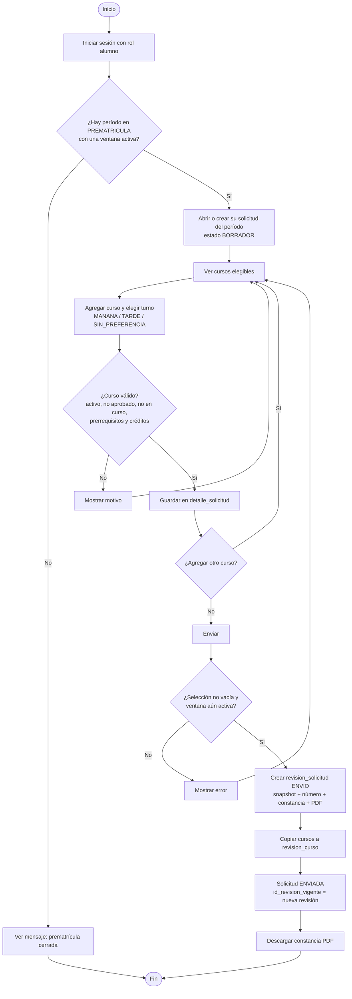
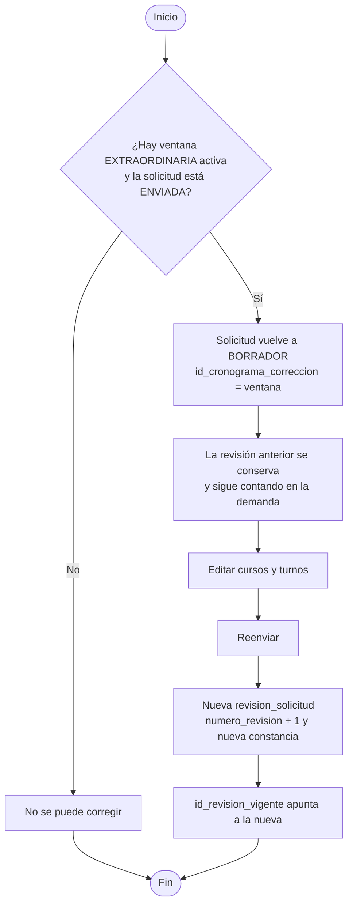
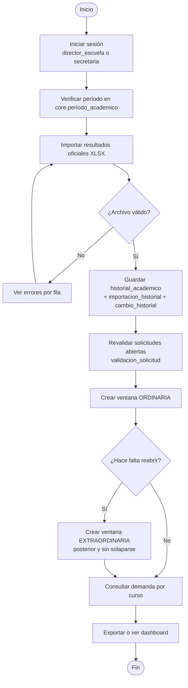
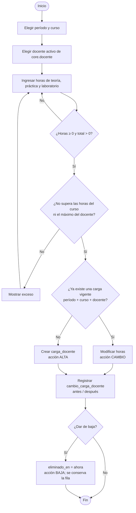
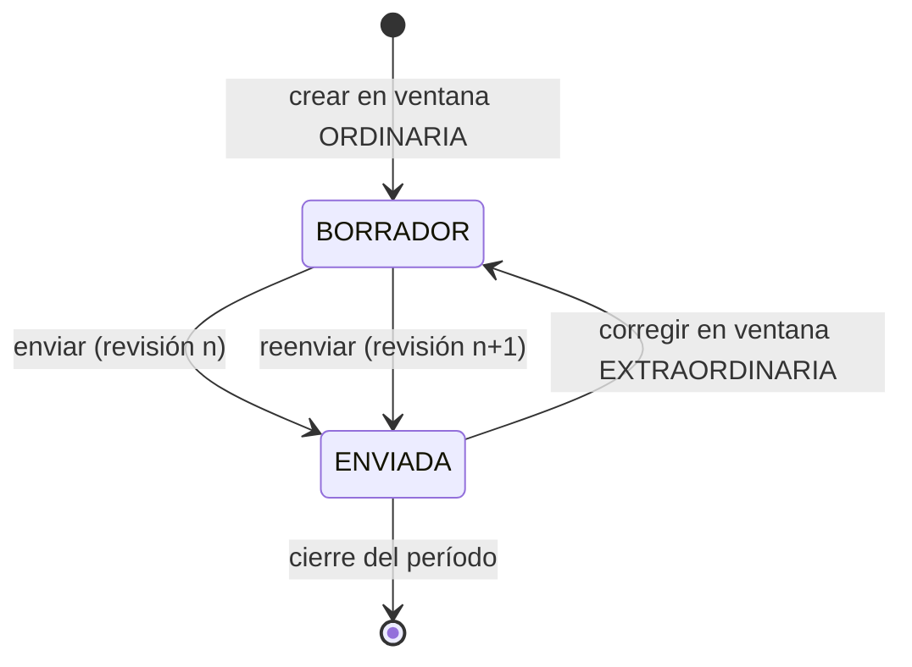

# Diagramas de flujo — Módulo Pre Matrícula

Los diagramas usan Mermaid: GitHub los dibuja automáticamente, y también se pueden pegar en [mermaid.live](https://mermaid.live) para exportarlos como imagen.

## 1. Estudiante: registrar la prematrícula

## 2. Estudiante: corregir en ventana extraordinaria

## 3. Coordinador: preparar el período

## 4. Coordinador: carga docente semanal

## 5. Estados de la solicitud

