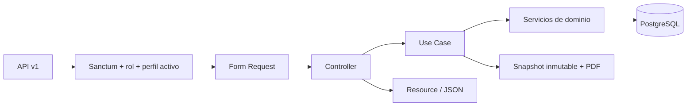

# Arquitectura

## Capas y responsabilidades

El punto de entrada REST es `routes/api.php`, bajo `/api/v1`. El middleware autentica con Sanctum, comprueba cuentas activas y el rol. Los Form Requests validan cuerpos y filtros; los controllers adaptan HTTP; los Use Cases coordinan operaciones y transacciones; los Services resuelven elegibilidad, importaciones, revisiones, PDF y agregados; los Resources definen el contrato público. Eloquent representa las relaciones y las migraciones imponen integridad.

Los endpoints de consulta también emplean agregados SQL y cargas anticipadas. No hay un servicio externo de horarios, cuentas docentes o matrícula definitiva. Las vistas preexistentes no se modifican.

## Tecnologías

- PHP 8.4.1+, Laravel 13.34 y Sanctum 4.
- PostgreSQL: JSONB, restricciones, claves foráneas, agregados, bloqueos de filas y asesores.
- `shuchkin/simplexlsx` y `simplexlsxgen`: lectura y generación XLSX, con inspección previa del ZIP/XML.
- Dompdf 3: constancia PDF A4 de una página, sin recursos remotos, PHP o JavaScript embebidos.
- PHPUnit 12, Pint, PHPStan 2 con Larastan 3 y parser de casts activado.
- Poppler para verificación externa de página, dimensiones y texto.
- OpenAPI 3.1 y Postman; Python solo para validación formal del documento.

Las versiones exactas y transitivas se fijan en `composer.lock`; las herramientas de documentación, en `requirements-quality.txt`.

## Operaciones y concurrencia

`AcademicProcessLock` serializa con una transacción y `pg_advisory_xact_lock(82640102)` las operaciones académicas que comparten invariantes. Se releen datos después de obtener el bloqueo. Las asignaciones también bloquean período, curso y docente antes de calcular capacidad.

`CurriculumCatalog` protege el grafo único con `82640101` y bloquea cursos por ID. Actualizar un curso toma primero el bloqueo académico y después el del catálogo; así, desactivar/reactivar revalida solicitudes abiertas de forma consistente. Importar resultados y registrar/corregir prematrículas comparten el bloqueo académico.

No se usa la ausencia de filas de asignaciones como un bloqueo: los padres y el bloqueo asesor protegen también la primera asignación. Las pruebas lanzan procesos PHP reales y verifican carreras por capacidad, límite docente, duplicación y registro de revisiones.

## Evidencia histórica y seguridad

Cada envío guarda snapshot, número de revisión, constancia y SHA-256 dentro de la misma transacción. Fallar el PDF o una auditoría revierte la operación. El PDF histórico se descarga del binario guardado; no se reconstruye con datos actuales. Un trigger PostgreSQL impide modificar o eliminar revisiones.

Las reglas HTTP son la frontera de acceso: estudiante propio, coordinador con cargo director o secretaría para gestión. Las relaciones se tipan explícitamente, los Resources filtran los atributos y las consultas parametrizan entradas. Los errores API son JSON; los errores internos no muestran SQL ni trazas, incluso si se activa debug por error. Los logs de consultas fallidas conservan conexión y SQLSTATE, no SQL ni bindings.
